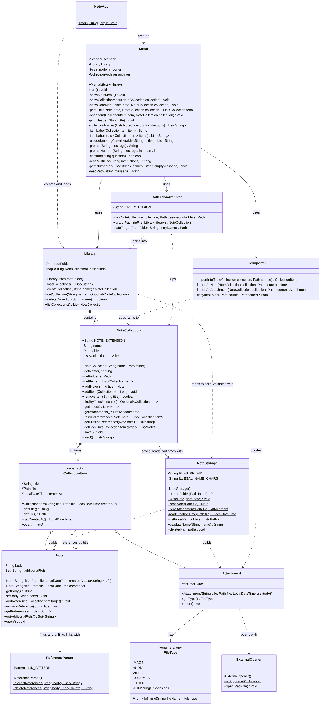

# Overview

As a software engineer, I wanted to explore java for the first time, and simultaneously tackle a topic I don't have much experience in with programming in general, file management. I used what I learned during a 2 week study period to write this notetaking application, NoteApp.

NoteApp is a console notetaking application built around connecting notes to each other. Notes live in **collections** (one folder per collection), and a note can link to any other item in its collection, either by writing `[[Title]]` in its text or by adding a link from the menu. When you open a note, the app shows what it links to, flags links that don't match anything, and lists every note that links back to it, so you can move through related notes in either direction. A collection can also hold files such as images, audio or PDFs, which open in your computer's default program. Plain `.txt` files you import become editable notes. Whole collections can be zipped to share with someone else and unzipped back into the library. I'm most proud of the fact that NoteApp uses native applications to open file types that the user imports into their collections.

My purpose for writing this software was to learn how to structure a Java program, how to store and reload data reliably as plain files, and how to handle user input and file problems without crashing.

[Software Demo Video](http://youtube.link.goes.here)

# Development Environment

- **Editor:** Visual Studio Code with Microsoft's **Extension Pack for Java**
- **Language:** Java (JDK 17 or newer; the code uses features from Java 16, such as `Stream.toList()` and pattern matching for `instanceof`)
- **Libraries:** only the Java standard library, with no outside dependencies:
  - `java.nio.file`: reading, writing, listing, copying and deleting files and folders
  - `java.util.regex`: finding and removing `[[Title]]` links in note text
  - `java.util.zip`: packing collections into `.zip` files and unpacking them
  - `java.awt.Desktop`: opening attachments in the computer's default program
  - `java.time`: note creation dates

# Setting Up and Running the Project

### 1. Install the tools

1. Install a **JDK, version 17 or newer**. [Eclipse Temurin](https://adoptium.net/) is a free option.
   To check, open a terminal and run `java -version`. It should report version 17 or higher.
2. Install [Visual Studio Code](https://code.visualstudio.com/).
3. In VS Code, open the Extensions view (Ctrl+Shift+X), search for **Extension Pack for Java**, and install it.

### 2. Get the code

```
git clone <this repository's URL>
```

### 3. Open the project in VS Code

1. Choose **File > Open Folder** and select the `note-app` folder itself, the one that contains `src` and `.vscode`. Opening a parent folder instead stops VS Code from recognizing the project.
2. If VS Code asks whether you trust the folder's authors, choose **Trust**. Java support is turned off in untrusted folders.
3. Open any `.java` file in `src/notes` and wait for the Java extension to finish loading (watch the status bar). The **Java Projects** panel in the Explorer should list the project with a `notes` package.

The included `.vscode/settings.json` tells VS Code that the source code is in `src` and compiled classes go in `bin`, so no other setup is needed.

### 4. Run it

Open `src/notes/NoteApp.java` and click **Run** above the `main` method. The app runs in VS Code's terminal.

**Without VS Code:** from the `note-app` folder, compile and run with:

```
javac -d bin src/notes/*.java
java -cp bin notes.NoteApp
```

### Troubleshooting

- **"... is a non-project file" or the Java Projects panel says there's no project:** make sure you opened the `note-app` folder itself and trusted it, then open a `.java` file. If it still doesn't load, press Ctrl+Shift+P and run **Java: Clean Java Language Server Workspace**.
- **"The declared package does not match the expected package":** VS Code is using the wrong folder as the source root. Check that `.vscode/settings.json` is directly inside the folder you opened.

# Using NoteApp

- **Where your notes are stored:** `Documents/NoteApp` in your user folder (for example `C:\Users\you\Documents\NoteApp`). Each collection is a folder, and each note is a `.txt` file in it. The folder is created the first time you run the app.
- **Menus:** type the letter for an option, or a number to choose an item from a list. Choosing **Back** returns to the previous menu.
- **Writing notes:** type your text and enter a line containing just `.` to finish.
- **Linking:** write `[[Title]]` anywhere in a note to link to another item in the same collection, for example `[[Packing List]]` or `[[campsite-map.png]]`. Capitalization doesn't matter. You can also add and remove links from the note's menu.
- **Importing:** **Import a file** copies a file into the collection. `.txt` files become notes; anything else becomes an attachment. Paths copied with Windows' "Copy as path" (with quotes) work.
- **Sharing:** **Zip to share** creates `CollectionName.zip`, and **Unzip a shared collection** adds a zipped collection to your library.
- **Saving:** changes are saved as soon as you make them, so there's nothing to save before quitting.

# Useful Websites

- [Java 17 API Documentation (Oracle)](https://docs.oracle.com/en/java/javase/17/docs/api/)
- [java.nio.file.Files (Oracle)](https://docs.oracle.com/en/java/javase/17/docs/api/java.base/java/nio/file/Files.html)
- [java.util.regex.Pattern (Oracle)](https://docs.oracle.com/en/java/javase/17/docs/api/java.base/java/util/regex/Pattern.html)
- [java.util.zip package (Oracle)](https://docs.oracle.com/en/java/javase/17/docs/api/java.base/java/util/zip/package-summary.html)
- [java.awt.Desktop (Oracle)](https://docs.oracle.com/en/java/javase/17/docs/api/java.desktop/java/awt/Desktop.html)
- [Getting Started with Java in VS Code](https://code.visualstudio.com/docs/java/java-tutorial)

# Future Work

- Rename notes and attachments, updating every `[[link]]` that points to them
- Search across the titles and text of all notes in a collection
- Store each note's creation date in its file, so dates survive zipping and copying
- Allow collections inside collections
- Add automated tests with JUnit for storage, linking, and zipping
- Handle the input stream ending (for example Ctrl+Z / Ctrl+D) by exiting cleanly instead of showing an error
- Build a graphical interface on top of the existing classes

# AI Usage Documentation

AI was used for a number of things when creating this program. 
- I used AI in conjunction with research to clarify my understanding
- AI was used to find bugs and explain edge cases I failed to catch
- AI was used in the creation of the Zipping functionality of the program
  - Originally I had planned to do this on my own but I had predesigned other features to include the functionality and other things began to take up my time.
  - Also this was a stretch feature from my original design and I felt that I'd learned what I wanted to about file management despite not having finished this feature.
- AI was used in the creation of the Enviornment Setup Documentation, and to make sure I hadn't missed inline documentation for classes, methods, etc.
- AI was used to create a UML for my program which I used to help wrap my head around the number of required components

# UML Diagram

